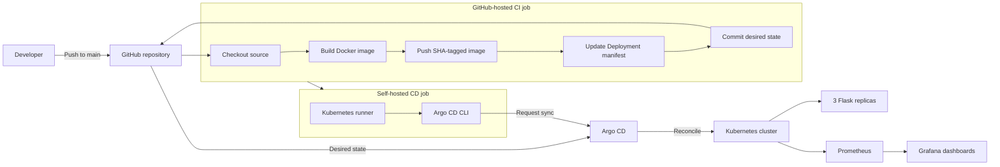

# DeployFlow

<p align="center">
  <strong>From a Flask commit to a monitored Kubernetes deployment.</strong>
</p>

<p align="center">
  A compact end-to-end DevOps project that containerizes a Python Flask application, publishes immutable Docker images, updates Kubernetes manifests, and synchronizes the deployment through Argo CD.
</p>

<p align="center">
  <a href="https://github.com/swayamkr03/DeployFlow/actions/workflows/devops.yaml">
    
  </a>
  
  
  
  
  
</p>

---

## Overview

DeployFlow demonstrates a complete application-delivery path:

1. A developer pushes application code to `main`.
2. GitHub Actions builds a Docker image and tags it with the commit SHA.
3. The image is published to Docker Hub.
4. The Kubernetes Deployment manifest is updated with the immutable image tag.
5. A self-hosted runner requests an Argo CD synchronization.
6. Argo CD reconciles the Git configuration with Kubernetes.
7. Prometheus and Grafana can monitor the resulting cluster and workloads.

The repository intentionally stays small so the delivery mechanics remain easy to inspect.

## Architecture



> **Delivery model:** Git stores the desired Kubernetes state. The current CD job explicitly calls `argocd app sync deployflow`; Argo CD then performs the Kubernetes reconciliation.

## Technology Stack

| Layer | Technology | Responsibility |
| --- | --- | --- |
| Application | Python + Flask | Serves the HTTP application |
| Packaging | Docker | Produces a portable application image |
| Registry | Docker Hub | Stores commit-specific images |
| Orchestration | Kubernetes | Runs and exposes the application |
| Continuous integration | GitHub Actions | Builds, publishes, and records the new image tag |
| Runner | Self-hosted GitHub Actions runner | Executes cluster-connected CD steps |
| Continuous delivery | Argo CD | Synchronizes Git with Kubernetes |
| Monitoring | Prometheus | Collects cluster and workload metrics |
| Visualization | Grafana | Displays monitoring dashboards |

## Repository Structure

```text
DeployFlow/
├── .github/
│   └── workflows/
│       └── devops.yaml          # CI/CD workflow
├── manifests/
│   ├── 01_devops.yaml           # devops namespace
│   ├── 02_devopsdep.yaml        # three-replica Deployment
│   └── 03_devopsdepsvc.yaml     # NodePort Service
├── .gitignore
├── app.py                       # Flask application
├── Dockerfile                   # application image definition
└── requirements.txt             # Python dependency list
```

## Application and Network Model

| Setting | Value |
| --- | --- |
| Flask route | `/` |
| Local Python port | `8088` |
| Container port | `8080` |
| Kubernetes namespace | `devops` |
| Deployment | `devopsdep` |
| Replicas | `3` |
| Service | `devopsdep` |
| Service port | `80` |
| Target port | `8080` |
| Lab NodePort | `31111` |
| Argo CD application | `deployflow` |

The application currently returns:

```text
Hello world
```

## Run Locally

### Python

```bash
git clone https://github.com/swayamkr03/DeployFlow.git
cd DeployFlow

python3 -m venv .venv
source .venv/bin/activate
pip install -r requirements.txt
python app.py
```

Open [http://localhost:8088](http://localhost:8088).

On Windows PowerShell, activate the environment with:

```powershell
.\.venv\Scripts\Activate.ps1
```

### Docker

```bash
docker build -t deployflow:local .
docker run --rm -p 8080:8080 deployflow:local
```

Open [http://localhost:8080](http://localhost:8080).

## Deploy to Kubernetes

### Prerequisites

- A running Kubernetes cluster
- `kubectl` configured for that cluster
- A container runtime on the cluster nodes
- Network access to pull the Docker Hub image

### Apply the manifests

```bash
kubectl apply -f manifests/
kubectl rollout status deployment/devopsdep -n devops
kubectl get deployments,pods,services -n devops -o wide
```

### Access the application safely

For local verification, prefer port-forwarding:

```bash
kubectl port-forward service/devopsdep 8080:80 -n devops
```

Then open [http://localhost:8080](http://localhost:8080).

The manifest also defines NodePort `31111` for the lab environment:

```text
http://<accessible-node-ip>:31111
```

If the cluster runs in a cloud VPC, the corresponding firewall or security-group rule must permit the port. Restrict the source range instead of exposing the port to the entire internet.

## CI/CD Pipeline

The workflow is defined in [`.github/workflows/devops.yaml`](.github/workflows/devops.yaml) and runs on pushes to `main`.

### CI job: `devops-ci`

Runs on a GitHub-hosted Ubuntu runner:

1. Checks out the repository.
2. Authenticates with Docker Hub.
3. Builds the image from `Dockerfile`.
4. Publishes `swayam0312/deployflow:<github-sha>`.
5. Updates `manifests/02_devopsdep.yaml` using `yq`.
6. Commits and pushes the new desired image tag.

Using `${{ github.sha }}` gives every build an immutable, traceable image reference.

### CD job: `devops-cd`

Runs after CI on a self-hosted runner with cluster connectivity:

1. Installs the Argo CD CLI.
2. Authenticates with the in-cluster Argo CD server.
3. Synchronizes the `deployflow` application.
4. Argo CD applies the version recorded in Git to Kubernetes.

## Required GitHub Secrets

Configure these under **Repository settings → Secrets and variables → Actions**:

| Secret | Purpose |
| --- | --- |
| `DOCKER_USERNAME` | Docker Hub account used to publish the image |
| `DOCKER_TOKEN` | Docker Hub access token with push permission |
| `ARGOCD_PASSWORD` | Argo CD credential currently expected by the lab workflow |

The workflow also needs permission to commit the updated manifest:

```yaml
permissions:
  contents: write
```

Depending on repository policy, configure this in the workflow or enable **Read and write permissions** for the repository's Actions token.

> **Production recommendation:** replace password-based Argo CD login with a least-privilege automation account and short-lived or carefully rotated token. Do not use the built-in admin account for routine delivery.

## Argo CD Configuration

The expected Argo CD application configuration is:

| Setting | Value |
| --- | --- |
| Repository | `https://github.com/swayamkr03/DeployFlow.git` |
| Revision | `main` |
| Manifest path | `manifests` |
| Destination cluster | `https://kubernetes.default.svc` |
| Destination namespace | `devops` |
| Application name | `deployflow` |

Equivalent `Application` resource:

```yaml
apiVersion: argoproj.io/v1alpha1
kind: Application
metadata:
  name: deployflow
  namespace: argocd
spec:
  project: default
  source:
    repoURL: https://github.com/swayamkr03/DeployFlow.git
    targetRevision: main
    path: manifests
  destination:
    server: https://kubernetes.default.svc
    namespace: devops
  syncPolicy:
    automated:
      prune: true
      selfHeal: true
    syncOptions:
      - CreateNamespace=true
```

Verify it with:

```bash
kubectl get applications -n argocd
kubectl describe application deployflow -n argocd
kubectl get deployments,pods,services -n devops
```

Remember that Argo CD reports two separate dimensions:

- **Synced** means the live Kubernetes resources match the desired state in Git.
- **Healthy** means the managed resources are operating successfully.

## Self-Hosted Runner

The CD job uses:

```yaml
runs-on: self-hosted
```

The runner must therefore be online, registered for this repository, and able to resolve and reach `argocd-server.argocd` inside the cluster.

Useful checks:

```bash
kubectl get pods -A | grep runner
kubectl get pods -n argocd
kubectl get service argocd-server -n argocd
```

If a job remains queued, confirm that at least one online runner matches every label listed in `runs-on`.

## Monitoring with Prometheus and Grafana

Prometheus and Grafana are installed at the cluster level rather than from this repository.

The monitoring path is:

```text
Kubernetes and node exporters
        → Prometheus scrapes and stores metrics
        → Grafana queries Prometheus
        → Dashboards display cluster, node, Pod, CPU, memory, and network health
```

Common verification commands:

```bash
kubectl get pods,services -n monitoring
kubectl get endpoints -n monitoring
```

For safer local Grafana access:

```bash
kubectl port-forward service/monitoringstack-grafana 3000:80 -n monitoring
```

Then open [http://localhost:3000](http://localhost:3000).

## Verification Checklist

- [ ] The GitHub Actions workflow is green.
- [ ] The Docker Hub repository contains the commit-SHA image tag.
- [ ] `manifests/02_devopsdep.yaml` references the same tag.
- [ ] Argo CD shows `Synced` and `Healthy`.
- [ ] Three application Pods are `Running` and `Ready`.
- [ ] The Service has ready endpoints.
- [ ] The Flask endpoint returns `Hello world`.
- [ ] Prometheus targets are healthy and Grafana displays cluster data.

## Troubleshooting

| Problem | What to check | Resolution |
| --- | --- | --- |
| Workflow cannot push the manifest commit | `github-actions[bot]` receives HTTP 403 | Grant `contents: write` and confirm repository Actions policy permits writes |
| Manual push of a workflow file is rejected | PAT lacks workflow-file permission | Use a properly scoped token; revoke any token exposed in a terminal or screenshot |
| Push is rejected with `fetch first` | Remote `main` has newer commits | Run `git pull --rebase origin main`, resolve conflicts, then push |
| CD job remains queued | No online self-hosted runner matches the labels | Check runner Pods, registration, connectivity, and `runs-on` labels |
| Docker login or push fails | Registry credentials or image name are wrong | Rotate the token and verify `DOCKER_USERNAME`, `DOCKER_TOKEN`, and repository access |
| Argo CD sync returns `PermissionDenied` | Automation identity lacks application sync permission | Grant least-privilege `applications, sync` access for the target project |
| Argo CD is `Synced` but `Degraded` | Desired state is applied, but a resource is unhealthy | Inspect Pods, events, probes, image pulls, and logs |
| Browser cannot reach the application | NodePort, firewall, Service endpoints, or Pods | Use port-forwarding first, then inspect the Service and cloud firewall |
| Grafana shows no data | Prometheus target, data source, or query issue | Check Prometheus targets, Grafana data source health, and dashboard time range |

Useful diagnostic commands:

```bash
kubectl get pods -n devops -o wide
kubectl get endpoints devopsdep -n devops
kubectl describe deployment devopsdep -n devops
kubectl logs deployment/devopsdep -n devops --tail=100
kubectl describe application deployflow -n argocd
```

## Security Notes

- Never commit Docker, GitHub, Kubernetes, or Argo CD credentials.
- Treat any token shown in a screenshot, terminal history, workflow log, or chat as compromised and revoke it.
- Use GitHub Secrets or an approved secret manager.
- Keep automation identities least-privileged.
- Prefer port-forwarding or an authenticated ingress over public NodePorts.
- Use trusted TLS and avoid `--insecure` outside a controlled lab.
- Restrict self-hosted runners because repository workflows can execute commands on them.
- Add resource requests, limits, health probes, and a non-root container user before treating this as a production deployment.

## Roadmap

- [ ] Add automated application tests before image publication.
- [ ] Pin Python dependencies and use a smaller non-root runtime image.
- [ ] Add Kubernetes readiness and liveness probes.
- [ ] Add CPU and memory requests and limits.
- [ ] Replace admin-password delivery with scoped Argo CD automation credentials.
- [ ] Store the Argo CD `Application` definition in Git.
- [ ] Manage monitoring configuration as code.
- [ ] Add an authenticated ingress with TLS.
- [ ] Add deployment and monitoring screenshots to this README.

## Author

Created by [Swayam Kumar](https://github.com/swayamkr03) as an end-to-end DevOps learning project covering Linux, Docker, Kubernetes, Prometheus, Grafana, GitOps, Argo CD, and GitHub Actions.

---

<p align="center">
  <strong>Source in Git. Images in the registry. Desired state reconciled by Argo CD.</strong>
</p>
